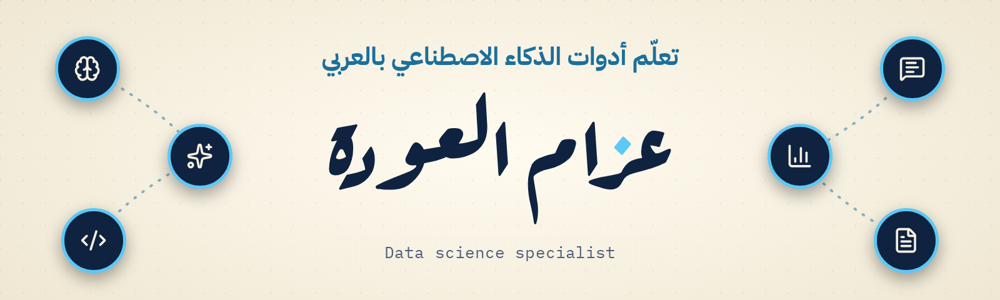
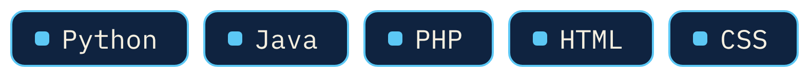

  <picture>
    <source media="(prefers-color-scheme: dark)" srcset="readme/banner-dark.png">
    
  </picture>

  
  
  
  
  
  
  

  

## أهلًا أنا عزام

بكالوريوس علم البيانات والذكاء الاصطناعي جامعة الأمير مساعد بن عبد الرحمن

**أشرح** أدوات الذكاء الاصطناعي بالعربي بفيديوهات قصيرة ومنشورات

**أتعلم الآن** Python و Java (البرمجة الكائنية) و PHP و HTML و CSS

**موقعي** [azzamaloudah.com](https://azzamaloudah.com) هنا أعرض من أنا وأشارك ما أتعلم

أدواتي

- Python و Java (البرمجة الكائنية) و PHP و HTML و CSS: أتعلمها الآن
- Cloudflare Workers: لاستضافة موقعي
- GitHub: لحفظ مشاريعي

  

## Hi, I'm Azzam

B.Sc. Data Science and AI at Prince Musaid bin Abdulrahman University

**Sharing** AI tools in Arabic through short videos and posts

**Learning now** Python, Java (OOP), PHP, HTML and CSS

**My website** [azzamaloudah.com](https://azzamaloudah.com) where I show who I am and share what I learn

My tools

- Python, Java (OOP), PHP, HTML and CSS: learning now
- Cloudflare Workers: hosts my website
- GitHub: keeps my projects

 

